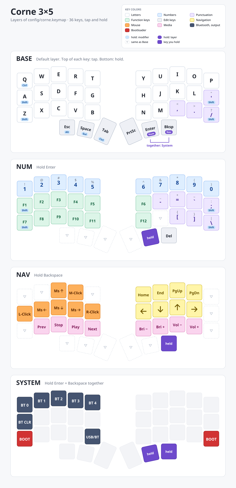

# zmk-config

ZMK firmware for a Corne 3x5 (Typeractive kit): nice!nano v2 controllers, no displays.
The keymap is in `config/corne.keymap`, and the build targets are listed in `build.yaml`.

The keymap was inspired by [Peter J's keymap](https://keymapdb.com/keymaps/peterxjang/).

A Dactyl Cygnus 4x6 keymap is built from the same shared pieces: see [cygnus/](cygnus/README.md).

## Keymap

Hold Enter for Num, hold Backspace for Nav, and press Enter + Backspace together and hold for System.



A faint grey key does nothing. A dashed key (▽) passes through to the Base layer. The purple "held" key is the one you are holding to be on that layer.

The picture is drawn from `config/corne.keymap` by `tools/draw-keymap.py` (needs `pycairo` and the Noto Sans font), so regenerate it after changing the keymap:

```sh
tools/draw-keymap.py
```

## Sharing between keyboards

The Corne is the reference. Everything a keyboard shares lives in `config/common*`, so a change there reaches every keyboard:

- `config/common/behaviors.dtsi`: the hold-taps (`&ht`, `&ht_space`, `&hs`, `&hsp`, `&lt`) and `&ltr`.
- `config/common/layers.dtsi`: every layer's keys, as one macro per row of each half (`BASE_L1`, `NUM_R2`, `NAV_TL`, ...).
- `config/common/combos.dtsi`: the Enter + Backspace combo for the System layer.
- `config/common.conf`: Kconfig settings every target gets (mouse keys, battery reporting, deep sleep). `build.sh` passes it to every build.

A keyboard's own keymap defines the few positions the behaviors depend on (where A and `/` are, and the two System combo keys), includes those files, then lays the macros out in its own matrix and adds its own extra keys. `config/corne.keymap` is the short example. To add a keyboard, copy a keymap, set those three positions, and add its targets to `build.yaml`.

## Building

The build runs locally in the official ZMK container, using podman:

```sh
./build.sh              # build everything in build.yaml -> firmware/*.uf2
./build.sh corne_left   # build one target
./build.sh --update     # pull newer ZMK/Zephyr first
./build.sh --pristine   # clean rebuild
```

The first run downloads ZMK, Zephyr and modules into `.zmk/`, which is gitignored. Later runs reuse them.

## Custom behaviors and tests

- `src/behaviors/behavior_layer_tap_repeat.c`: the Backspace/Nav key (`&ltr`). Tap for Backspace, hold for Nav, and hold alone to repeat Backspace.
- `src/behaviors/behavior_hold_tap_follow.c`: a copy of ZMK's hold-tap with one extra setting, `hold-follow-key-positions`, which makes two quick chords always give the shifted key, however fast and whichever key is released first: Z then `/` types `?`, and `'` then A types `A`. Hold-taps share global state, so every hold-tap in the keymap uses this copy (the stock `&mt` is disabled), and it needs syncing by hand if ZMK's hold-tap changes.

`./test.sh` runs the simulator tests in `tests/` against both (`./test.sh layer-tap-repeat/02-*` runs one). The tests include `config/common/behaviors.dtsi`, so they run the same hold-taps as the keymaps. Each test replays timed key presses and compares the keycodes sent with a snapshot (`./test.sh --accept` rewrites the snapshots, so check the diff). Run `./build.sh` once first.

## Flashing

Double-tap reset on a nice!nano to mount it as a USB drive, then copy the matching `.uf2` onto it.
You can also hold Enter + Backspace (System layer) and press `BOOT`, the bottom outer key on either side.

If the halves won't pair, flash `settings_reset.uf2` to both halves, then flash the normal firmware again.

The left half is the central and has ZMK Studio enabled over USB, at <https://zmk.studio>.

## Sleep

Each half goes into deep sleep after 30 minutes without a key press (`CONFIG_ZMK_SLEEP` and `CONFIG_ZMK_IDLE_SLEEP_TIMEOUT=1800000` in `config/common.conf`). Asleep it is powered off apart from the key matrix, so the battery barely drains.

- Any key press wakes it. The Bluetooth connection was dropped, so the keyboard reconnects to the host, which takes a second or two, and the key that woke it is usually lost.
- Each half sleeps on its own timer. Typing only on the left for 30 minutes can put the right half to sleep; pressing a key on it wakes it and it re-pairs with the left half.
- It never sleeps while USB power is connected.
- Without `CONFIG_ZMK_SLEEP` a ZMK keyboard never sleeps at all (ZMK's separate 30-second "idle" state only turns off things like displays and backlight, and these boards have none).

## Battery

Both halves report their battery level over Bluetooth. `config/corne.conf` enables `CONFIG_ZMK_SPLIT_BLE_CENTRAL_BATTERY_LEVEL_FETCHING` and `..._PROXY`, so the left half (central) also passes on the right half's level as a second Battery Service.

On Linux (BlueZ), `org.bluez.Battery1.Percentage` (what upower and most desktops show) only reports the left half; bluetoothd uses the first Battery Service and ignores the rest.
To read both, read the Battery Level characteristics (`0x2A19`) over GATT. The right half's has a User Description (`0x2901`) of `Peripheral 0`, and the left half's has none.
A status bar such as waybar can be configured to read these and show both percentages.

After changing these settings, remove and re-pair the keyboard so the host picks up the new service.
Press `BT CLR` on the System layer to clear the keyboard's side too. ZMK asks the host to confirm pairing, so `bluetoothctl pair` needs an agent (`agent NoInputNoOutput`, then `default-agent`, in an interactive `bluetoothctl`), or it fails with `AuthenticationFailed`.
