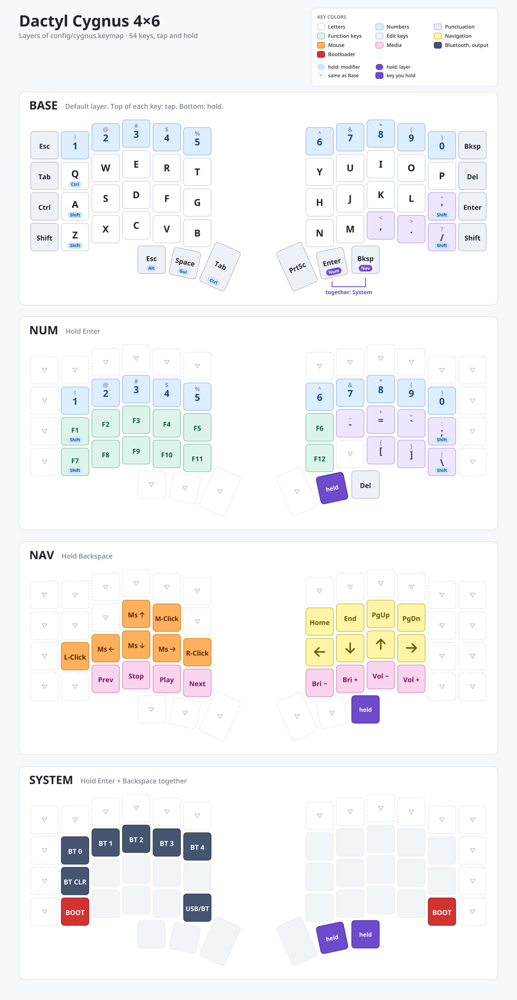

# Dactyl Cygnus 4x6

The [Corne keymap](../Readme.md#keymap) on the Dactyl Cygnus 4x6: the same hold-taps, layers, System combo and settings, plus the extra keys this board has. The keymap is `config/cygnus.keymap`; the shield definition is in `boards/shields/cygnus` (much of that code comes from <https://github.com/juhakaup/zmk-cygnus-4x6>).

Hold Enter for Num, hold Backspace for Nav, and press Enter + Backspace together and hold for System.

A faint grey key does nothing. A dashed key (▽) passes through to the Base layer. The purple "held" key is the one you are holding to be on that layer. The thumb keys in this picture are only roughly where they are on the board.

## Extra keys

The Corne's 3x5 keys, plus:

- a number row on top (Esc, 1-0, Bksp);
- an outer column on each side: Tab, Ctrl, Shift on the left; Del, Enter, Shift on the right.

The extra keys pass through on the Num, Nav and System layers, so they keep working there.

## Sharing with the Corne

`config/cygnus.keymap` is about 50 lines: it sets the three positions the shared behaviors need (A is position 25, `/` is 46, and Enter and Backspace are 52 and 53), includes `config/common/*.dtsi`, and lays the shared row macros (`BASE_L1`, `NUM_R2`, ...) out in the Cygnus's matrix with its extras. Change a layer in `config/common/layers.dtsi` and both keyboards get it. The Kconfig settings (including the 30-minute deep sleep) are in `config/common.conf`.

## Building

`./build.sh cygnus` builds `cygnus_left.uf2` and `cygnus_right.uf2` into `firmware/` (nice!nano v2 controllers). It builds, but I haven't tried it on a board yet.

The picture is drawn from the keymap by `tools/draw-keymap.py`; regenerate it after changing the keymap.
